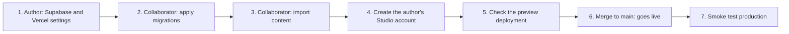

# Going Live: Deployment Runbook

This runbook moves the production site from the old JSON version to the Supabase-backed version with the Studio.

**Time needed:** about 30 minutes.
**People:**
- **the author**, for dashboard clicks only
- **the collaborator**, for terminal commands

> **Order matters.**
> - The new code reads from database tables. Those tables must exist in production **before** the pull request is merged.
> - Until they exist, Vercel preview builds of the branch will fail. That's expected.



---

## 1. Author: dashboard settings (about 10 minutes, no code)

### Supabase (https://supabase.com/dashboard → project `ulaehzbtnsvzpuezicdx`)

| # | Where | What to do |
|---|-------|-----------|
| 1.1 | **Authentication → Sign In / Providers** | Turn **OFF** "Allow new users to sign up". Keep the **Email** provider **ON**, because the Studio logs in with it. |
| 1.2 | **Authentication → Sign In / Providers → Email** | Set the minimum password length to **12**. Under password requirements, choose **lowercase, uppercase letters and digits**. |
| 1.3 | **Authentication → URL Configuration** | Set **Site URL** to the live domain, e.g. `https://emergent-blog.vercel.app` or the custom domain. |
| 1.4 | **Organization → Team → Invite** | Invite the collaborator's email with the **Developer** role. This lets them apply migrations without the database password ever being shared. |
| 1.5 | **Project Settings → API Keys → Secret keys** | Create a secret key if none exists. Then either paste it into Vercel yourself (step 1.6) or share it with the collaborator through a **password manager**. Never send it by chat or email. |

### Vercel (https://vercel.com → project `emergent-blog` → Settings → Environment Variables)

| # | Variable | Value | Environments |
|---|----------|-------|--------------|
| 1.6 | `SUPABASE_SECRET_KEY` | the secret key from 1.5. Tick **Sensitive**. | Production, Preview |
| 1.7 | `NEXT_PUBLIC_SITE_URL` | the live URL, e.g. `https://emergent-blog.vercel.app` | Production |
| 1.8 | `NEXT_PUBLIC_SUPABASE_URL`, `NEXT_PUBLIC_SUPABASE_PUBLISHABLE_KEY` | these should already be set. Check that both are present. | Production, Preview |

Also check **Settings → General → Node.js Version** is **22.x** or newer.

> **Note:** Preview deployments use the **same** Supabase project as production. Content created while testing a preview is real content.

---

## 2. Collaborator: apply the database migrations

```bash
git checkout feat/dynamic-site && git pull
npm ci

npx supabase login                                     # opens the browser; use your own invited account
npx supabase link --project-ref ulaehzbtnsvzpuezicdx

npx supabase db push --dry-run                         # shows the 2 migrations that will run
npx supabase db push                                   # applies them
```

To verify, run the read-only check from earlier. It should now report the `posts`, `documents` and `profiles` tables, plus **sign-ups disabled**.

---

## 3. Collaborator: import the existing content

Add the secret key to **your local** `.env.local`, which is git-ignored:

```bash
SUPABASE_SECRET_KEY=sb_secret_...
```

Then run:

```bash
npm run content:import -- --confirm     # --confirm is required for a remote project
```

Expected output: **4 essays** published and **2 documents**. The "Test Document" is imported as a draft. Running it again is safe; it updates the same rows instead of adding duplicates.

---

## 4. Create the author's Studio account

Agree with the author on a **username** (lowercase letters, numbers, `_`) and the **email** to attach.

```bash
npm run studio:create-admin -- --username <username> --email <author-email> --confirm
```

The password is typed at a hidden prompt.

- **Best:** the author types it during a screen share.
- **Alternative:** set a temporary password and have the author change it immediately under **Studio → @username → Change password**.

Rules: at least 12 characters, with upper- and lowercase letters and a number.

---

## 5. Check the preview deployment

Open the Vercel preview for the pull request. The link is in the PR checks. Then:

- [ ] Home page shows the 4 essays; `/archive`, `/documents` and one essay page load.
- [ ] `/documents/cyclical-businesses-reference` opens the PDF.
- [ ] `/studio` redirects to the login page, and logging in with the new account works.
- [ ] Create a test essay → **Publish** → it appears on the preview site → **Delete** it.

---

## 6. Merge

Merge the pull request(s) into `main`. Vercel deploys production automatically.

## 7. Smoke test production

Repeat the step 5 checklist on the live URL, and also check:

- [ ] `https://<domain>/sitemap.xml` and `/rss.xml` load.
- [ ] `https://<domain>/robots.txt` shows `Disallow: /studio`.

---

## Rollback

| Problem | Action |
|---------|--------|
| The new site misbehaves | Vercel → Deployments → pick the last deployment from before the merge → **Instant Rollback**. The old version reads JSON files and ignores the database entirely, so this fully restores it. |
| A bad migration | Migrations only **add** tables, functions and policies; nothing existing is altered. Fix forward with a new migration rather than editing an applied one. |
| Locked out of the Studio | Wait 15 minutes; the lockout clears itself. If the password is forgotten, re-run step 4 with the same email to reset it. |

## Ongoing maintenance

- **Schema changes:**
  - Add a new file under `supabase/migrations/` with `npx supabase migration new <name>`.
  - Test it locally with `npm run db:reset && npm run db:test`.
  - Apply it with `npx supabase db push` before merging code that depends on it.
  - Regenerate types with `npm run db:types`.
- **Backups:** the Supabase free plan keeps no point-in-time backups. Consider the Pro plan (daily backups and PITR), or a scheduled `supabase db dump`.
- **Dependencies:** Dependabot opens weekly pull requests, and CI must pass before you merge them.
- **Rotating the secret key:**
  1. Create a new secret key in Supabase.
  2. Update it in Vercel and redeploy.
  3. Delete the old key.
