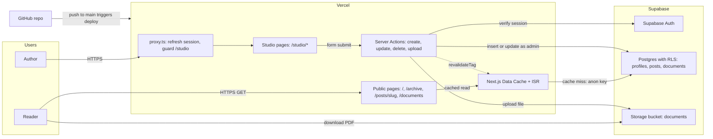
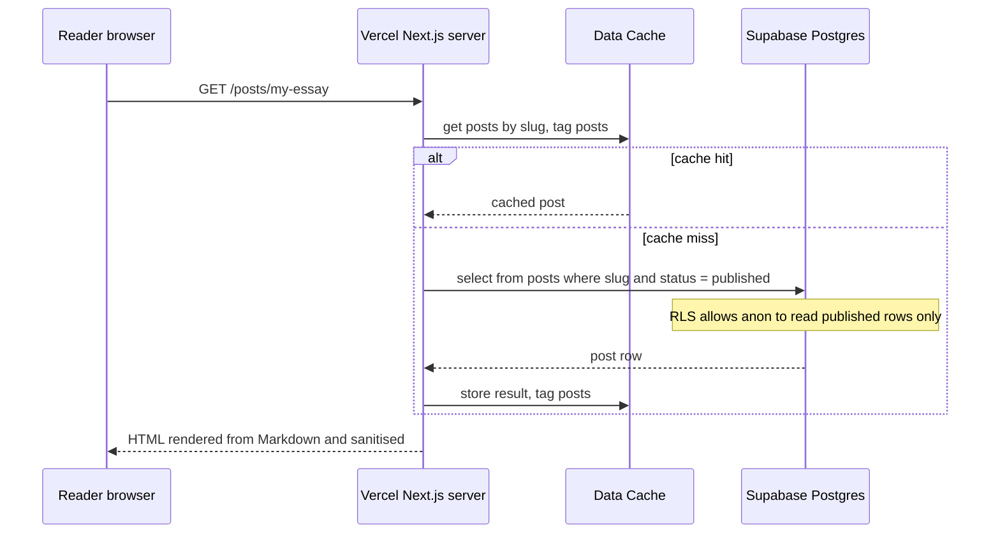
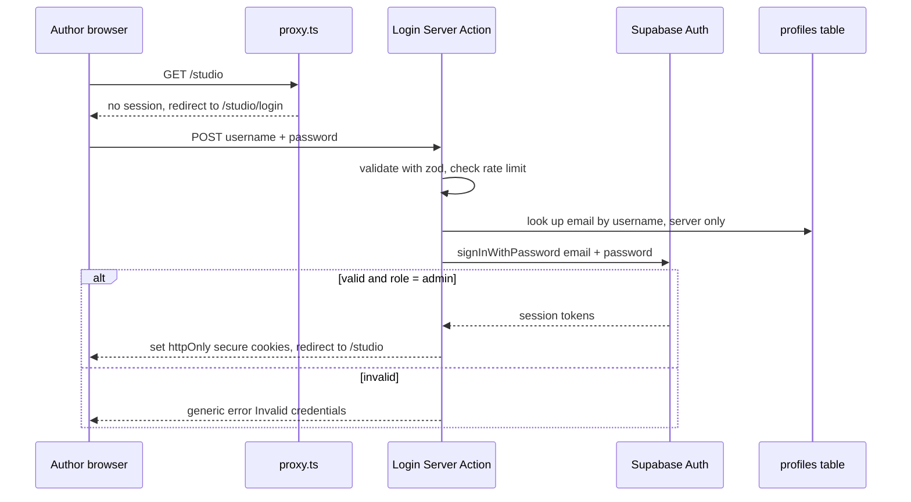
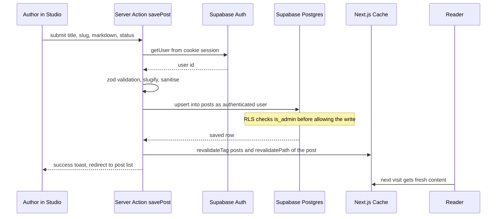
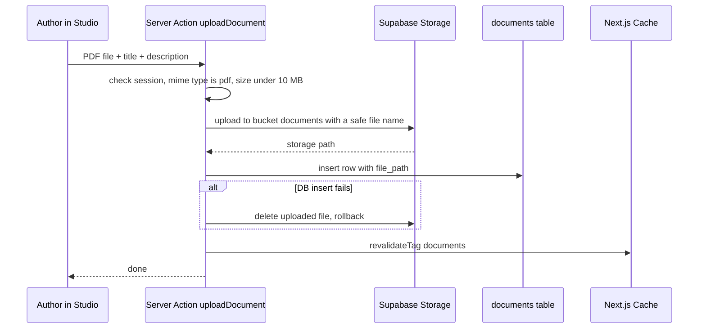
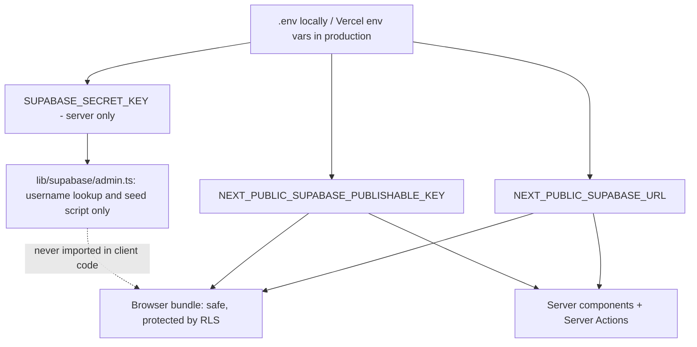
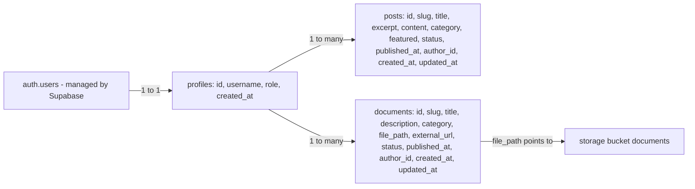
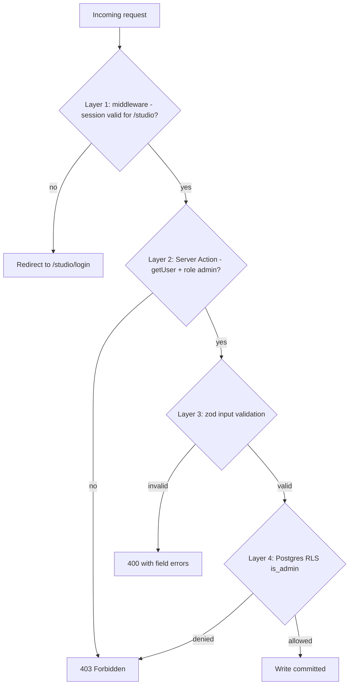
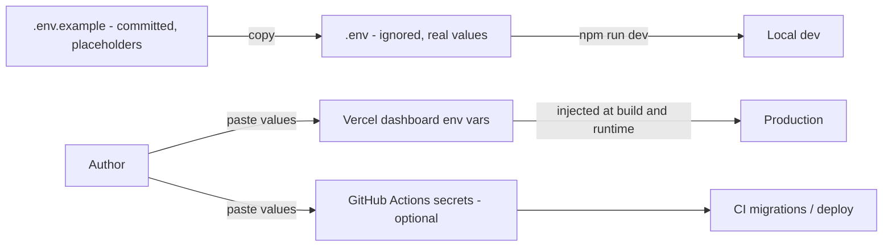

# Emergent Thoughts: Improvements Plan

> **Goal:** turn the static, JSON-based blog into a **dynamic site**:
> - Content is stored in **Supabase** (Postgres + Auth + Storage).
> - The author publishes from a password-protected **Studio** at `/studio`.
> - The site is deployed on **Vercel**.
>
> **Audience:** the owner (SanketAdk) and collaborators.
> **Progress (24 Nov 2026):**
> - ✅ Stages 1–7 are implemented and tested on branch `feat/dynamic-site`.
> - ⏳ Stage 8, going live, follows [`DEPLOYMENT.md`](DEPLOYMENT.md).
> - Differences from this plan: PDFs use a **private** bucket served through signed URLs; there's a Studio **account page** for password changes; and the login rate limit lives **in Postgres**, so no extra service is needed.
>
> **Naming notes:**
> - Next.js 16 renamed `middleware.ts` to `proxy.ts`.
> - Supabase's newer key names are used: `PUBLISHABLE_KEY` replaces the old anon key, and `SECRET_KEY` replaces the old service-role key.
>
> **Companion docs:**
> - [`README.md`](README.md): the current state of the project
> - [`docs/infrastructure.drawio`](docs/infrastructure.drawio): editable diagrams. Page 5 covers the Supabase integration.

---

## Table of Contents

1. [Requirements](#1-requirements)
2. [Before vs After](#2-before-vs-after)
3. [Target Architecture](#3-target-architecture)
4. [Information Flow: Database ↔ Site](#4-information-flow-database--site)
5. [Database Design](#5-database-design)
6. [Security Model](#6-security-model)
7. [Environment Variables & Secrets](#7-environment-variables--secrets)
8. [Author-Provided Values Checklist](#8-author-provided-values-checklist)
9. [Target Project Structure](#9-target-project-structure)
10. [Multi-Stage Build Prompts](#10-multi-stage-build-prompts)
11. [Industry Best Practices Applied](#11-industry-best-practices-applied)
12. [Definition of Done](#12-definition-of-done)

---

## 1. Requirements

| # | Requirement | Decision |
|---|-------------|----------|
| R1 | **Database integration** | **Supabase** provides the Postgres database, Auth, and Storage for PDFs. |
| R2 | **Owned by the author** | The Supabase project is created under the **author's own Supabase account**, signed in with the author's GitHub. Collaborators get access by invitation and never own the project. |
| R3 | **`.gitignore`** | Ignore `.env`, `.env*.local`, `node_modules`, `.next`, `.DS_Store` and `.vercel`. Explicitly allow `.env.example`. |
| R4 | **Two env files** | `.env` holds real secrets, is **ignored**, and is never pushed. `.env.example` lists the variable names with placeholder values and **is committed**. |
| R5 | **Studio login** | `/studio` requires a **username + password** login. Public sign-up is disabled; the author account is created manually. |
| R6 | **Publish from the backend** | The Studio can create, edit, draft, publish and delete **essays**, and upload and manage **documents** (PDFs). |
| R7 | **Industry standard** | Row Level Security, server-only secrets, input validation, on-demand revalidation, typed database, migrations kept in git, CI, and security headers. |
| R8 | **Credentials supplied by the author** | The author supplies the Supabase and Vercel credentials. They go into `.env` and the Vercel dashboard, **never into source code**. See [§8](#8-author-provided-values-checklist). |

> **Note on "hardcoded" credentials:** the author provides these values, but they must never be written into `.ts` / `.tsx` files or committed. Code reads them from `process.env.*`. Values live in `.env` for local development and in **Vercel → Project → Settings → Environment Variables** for production.

---

## 2. Before vs After

| Area | Now (static) | After (dynamic) |
|------|--------------|-----------------|
| Content store | `data/posts.json` in git | Supabase Postgres tables `posts` and `documents` |
| Publishing | Edit JSON → commit → redeploy | Studio form → saved to the database → page refreshes in seconds, with no redeploy |
| PDFs | `public /documents` (broken path) | Supabase Storage bucket `documents` |
| Auth | None | Supabase Auth with username/password and a single admin role |
| Post body | Plain text | Markdown, sanitised on render |
| Drafts | Not possible | `status = draft / published` |
| Rendering | SSG at build time | Static pages + **on-demand revalidation** (ISR) |
| Secrets | None | `.env` locally and Vercel env vars in production |
| CI | None | GitHub Actions: lint, typecheck, build |

---

## 3. Target Architecture



**Key ideas**
- Readers **never talk to the database directly from the browser**. Public pages are rendered on the server and cached.
- The Studio writes **only through Server Actions**. Those actions run on the server, check the session, and validate input before they touch Supabase.
- **RLS is the last line of defence.** Even if application code has a bug, the database rejects writes from anyone who is not the admin.
- After a write, `revalidateTag('posts')` clears the cache, so the public site shows the change on the next request.

---

## 4. Information Flow: Database ↔ Site

### 4.1 Reader opens an essay (read path)



### 4.2 Author logs in to the Studio



### 4.3 Author publishes an essay (write path)



### 4.4 Author uploads a document (PDF)



### 4.5 Which key is used where



---

## 5. Database Design



### Reference SQL (goes into `supabase/migrations/0001_init.sql`)

```sql
-- Enums
create type content_status as enum ('draft', 'published');
create type user_role      as enum ('admin', 'author');

-- Profiles (1:1 with auth.users)
create table public.profiles (
  id         uuid primary key references auth.users(id) on delete cascade,
  username   text unique not null check (username ~ '^[a-z0-9_]{3,32}$'),
  role       user_role not null default 'author',
  created_at timestamptz not null default now()
);

-- Posts
create table public.posts (
  id           uuid primary key default gen_random_uuid(),
  slug         text unique not null check (slug ~ '^[a-z0-9-]+$'),
  title        text not null,
  excerpt      text not null default '',
  content      text not null default '',          -- Markdown
  category     text,
  featured     boolean not null default false,
  status       content_status not null default 'draft',
  published_at timestamptz,
  author_id    uuid references public.profiles(id),
  created_at   timestamptz not null default now(),
  updated_at   timestamptz not null default now()
);
create index posts_status_published_at_idx on public.posts (status, published_at desc);

-- Documents
create table public.documents (
  id           uuid primary key default gen_random_uuid(),
  slug         text unique not null,
  title        text not null,
  description  text not null default '',
  category     text,
  file_path    text,                                -- path inside storage bucket
  external_url text,                                -- e.g. Google Docs link
  status       content_status not null default 'draft',
  published_at timestamptz,
  author_id    uuid references public.profiles(id),
  created_at   timestamptz not null default now(),
  updated_at   timestamptz not null default now(),
  constraint documents_source_chk check (file_path is not null or external_url is not null)
);

-- updated_at trigger
create or replace function public.set_updated_at() returns trigger
language plpgsql as $$ begin new.updated_at = now(); return new; end $$;
create trigger posts_updated_at     before update on public.posts     for each row execute function public.set_updated_at();
create trigger documents_updated_at before update on public.documents for each row execute function public.set_updated_at();

-- Admin helper (security definer so policies can call it)
create or replace function public.is_admin() returns boolean
language sql stable security definer set search_path = public as $$
  select exists (select 1 from public.profiles where id = auth.uid() and role = 'admin');
$$;

-- Row Level Security
alter table public.profiles  enable row level security;
alter table public.posts     enable row level security;
alter table public.documents enable row level security;

create policy "public reads published posts" on public.posts
  for select using (status = 'published' or public.is_admin());
create policy "admin writes posts" on public.posts
  for all using (public.is_admin()) with check (public.is_admin());

create policy "public reads published documents" on public.documents
  for select using (status = 'published' or public.is_admin());
create policy "admin writes documents" on public.documents
  for all using (public.is_admin()) with check (public.is_admin());

create policy "user reads own profile" on public.profiles
  for select using (id = auth.uid());
```

Storage bucket `documents`:
- **public read**
- write and delete allowed **only when `public.is_admin()`**, set through storage policies in `0002_storage.sql`
- allowed MIME type `application/pdf`
- maximum size 10 MB

---

## 6. Security Model



| Control | Implementation |
|---------|----------------|
| Sign-ups disabled | Supabase → Auth → Providers → Email → turn off **"Allow new users to sign up"**. |
| Username login | Usernames are stored in `profiles`. The server looks up the matching email with the service-role key and then calls `signInWithPassword`. The username → email mapping is never exposed to the browser. |
| Uniform errors | Every login failure returns *"Invalid credentials"*, so attackers can't tell which usernames exist. |
| Brute-force protection | Supabase Auth's built-in rate limits, plus a per-IP limit on the login action (Upstash Ratelimit or a simple Postgres counter). |
| Sessions | `@supabase/ssr` with **httpOnly, Secure, SameSite=Lax** cookies, refreshed in middleware. Always use `getUser()`, never trust `getSession()` on the server. |
| Secrets | The service-role key is only used in `lib/supabase/admin.ts`, which is marked with `import 'server-only'`. |
| XSS | Markdown is rendered with `react-markdown` + `rehype-sanitize`. No `dangerouslySetInnerHTML` for user content. |
| Headers | `next.config.ts` sets CSP, `X-Frame-Options: DENY`, `Referrer-Policy`, `Permissions-Policy` and HSTS. |
| Uploads | MIME and size checks on the server, file names generated by the server (`uuid.pdf`), and storage policies. |
| Studio indexing | `/studio` is marked `noindex` and disallowed in `robots.ts`. |

---

## 7. Environment Variables & Secrets

### `.gitignore` (additions)

```gitignore
# dependencies / build
node_modules/
.next/
out/
.vercel/

# env files – never commit real secrets
.env
.env*.local
!.env.example

# OS / editor
.DS_Store
*.log
.idea/
.vscode/

# supabase local
supabase/.temp/
supabase/.branches/
```

### `.env.example` (committed)

```bash
# ───── Supabase (Project Settings → API) ─────
NEXT_PUBLIC_SUPABASE_URL=https://your-project-ref.supabase.co
NEXT_PUBLIC_SUPABASE_PUBLISHABLE_KEY=your-anon-or-publishable-key
SUPABASE_SECRET_KEY=your-service-role-or-secret-key   # server only, never expose

# ───── Site ─────
NEXT_PUBLIC_SITE_URL=http://localhost:3000

# ───── Optional: CLI / CI (only if deploying or migrating from CI) ─────
SUPABASE_PROJECT_REF=your-project-ref
SUPABASE_DB_PASSWORD=your-db-password
SUPABASE_ACCESS_TOKEN=your-supabase-personal-access-token
VERCEL_TOKEN=your-vercel-token
VERCEL_ORG_ID=your-vercel-org-id
VERCEL_PROJECT_ID=your-vercel-project-id
```

`.env` (ignored) uses the **same keys with real values**. Validate env vars at startup with a zod schema in `lib/env.ts`, so a missing variable fails the build instead of failing at runtime.



---

## 8. Author-Provided Values Checklist

Only the **author (project owner)** can provide these, because they come from accounts the author owns. Collaborators must **not** create these accounts on the author's behalf.

### Supabase (https://supabase.com, *Continue with GitHub* using the author's GitHub)

| Value | Where to find it | Goes into |
|-------|------------------|-----------|
| Project URL | Project Settings → API | `NEXT_PUBLIC_SUPABASE_URL` |
| Anon / Publishable key | Project Settings → API Keys | `NEXT_PUBLIC_SUPABASE_PUBLISHABLE_KEY` |
| Service role / Secret key | Project Settings → API Keys (**secret**) | `SUPABASE_SECRET_KEY` |
| Project ref | The ID in the project URL | `SUPABASE_PROJECT_REF` (CLI/CI only) |
| Database password | Set when creating the project | `SUPABASE_DB_PASSWORD` (CLI/CI only) |
| Personal access token | Account → Access Tokens | `SUPABASE_ACCESS_TOKEN` (CI only) |
| Studio admin user | Auth → Users → **Add user** (email + strong password) | Then insert a `profiles` row with `username` and `role = 'admin'` |
| Disable sign-ups | Auth → Providers → Email | Toggle off |
| Site URL / Redirect URLs | Auth → URL Configuration | The production domain and `http://localhost:3000` |
| Invite collaborator (optional) | Organization → Team | Collaborator's email, *Developer* role |

### Vercel (https://vercel.com, signed in with the author's GitHub)

| Value / action | Where | Notes |
|----------------|-------|-------|
| Import repo | New Project → `SanketAdk/Emergent-Blog-` | Pushes to `main` deploy automatically; no token needed in the repo. |
| Env vars | Project → Settings → Environment Variables | Add the 3 Supabase vars + `NEXT_PUBLIC_SITE_URL` for **Production** and **Preview**. |
| Supabase integration (optional) | Vercel Marketplace → Supabase | Syncs Supabase env vars automatically. |
| Custom domain | Project → Domains | Update `NEXT_PUBLIC_SITE_URL` and the Supabase redirect URLs to match. |
| `VERCEL_TOKEN`, `VERCEL_ORG_ID`, `VERCEL_PROJECT_ID` | Account → Tokens; `.vercel/project.json` | **Only** needed if deploying from GitHub Actions instead of the Git integration. |
| Add collaborator | Team → Members | Lets collaborators see preview deployments and logs. |

### GitHub (repo settings)

- Add the collaborator with **Write** access.
- Turn on **branch protection** on `main`: require a PR and a passing CI check.
- Add **Actions secrets** for any CI variables listed above.

---

## 9. Target Project Structure

```
Emergent-Blog-/
├── .env.example                 # committed
├── .env                         # ignored
├── .gitignore
├── .github/workflows/ci.yml     # lint + typecheck + build
├── proxy.ts                # session refresh + /studio guard
├── next.config.ts               # security headers, images.remotePatterns for Supabase
├── app/
│   ├── (site)/                  # public pages
│   │   ├── page.tsx
│   │   ├── archive/page.tsx
│   │   ├── posts/[slug]/page.tsx
│   │   ├── documents/page.tsx
│   │   └── category/[name]/page.tsx
│   ├── studio/                  # protected
│   │   ├── login/page.tsx
│   │   ├── layout.tsx           # checks admin, noindex
│   │   ├── page.tsx             # dashboard
│   │   ├── posts/page.tsx       # list
│   │   ├── posts/new/page.tsx
│   │   ├── posts/[id]/edit/page.tsx
│   │   └── documents/page.tsx
│   ├── sitemap.ts · robots.ts · rss.xml/route.ts
│   └── layout.tsx
├── actions/                     # server actions ('use server')
│   ├── auth.ts                  # login, logout
│   ├── posts.ts                 # create, update, delete, publish
│   └── documents.ts             # upload, update, delete
├── lib/
│   ├── env.ts                   # zod-validated env
│   ├── supabase/
│   │   ├── server.ts            # createServerClient (cookies)
│   │   ├── client.ts            # createBrowserClient
│   │   ├── admin.ts             # service role, import 'server-only'
│   │   └── proxy.ts        # updateSession helper
│   ├── queries/posts.ts         # cached reads (unstable_cache / 'use cache' + tags)
│   ├── queries/documents.ts
│   ├── validation.ts            # zod schemas
│   └── markdown.tsx             # react-markdown + rehype-sanitize
├── types/database.types.ts      # generated: supabase gen types typescript
├── components/
│   ├── site/…                   # Navigation, PostCard, DocumentCard, Bio
│   └── studio/…                 # PostForm, MarkdownEditor, DocumentUpload, DataTable
├── supabase/
│   ├── config.toml
│   ├── migrations/0001_init.sql
│   ├── migrations/0002_storage.sql
│   └── seed.sql
├── scripts/migrate-json-to-supabase.ts   # one-time import of data/posts.json
└── public/                      # renamed (trailing space removed)
```

---

## 10. Multi-Stage Build Prompts

Each stage is a **self-contained prompt** for an AI coding assistant (e.g. Claude Code) or a developer.

- Run the stages **in order**, each on its own branch and PR.
- Don't start a stage until the previous one's acceptance criteria pass.
- Stage 0 is done by hand by the author.

```mermaid
graph LR
  S0["Stage 0: Author setup - manual"] --> S1["Stage 1: Housekeeping and env"]
  S1 --> S2["Stage 2: Supabase schema and RLS"]
  S2 --> S3["Stage 3: Data layer and public site on Supabase"]
  S3 --> S4["Stage 4: Auth and Studio login"]
  S4 --> S5["Stage 5: Studio CRUD for posts and documents"]
  S5 --> S6["Stage 6: Public enhancements and SEO"]
  S6 --> S7["Stage 7: Hardening, tests, CI"]
  S7 --> S8["Stage 8: Production deploy and data migration"]
```



### Stage 0: Author setup (manual, no code)

Complete the [§8 checklist](#8-author-provided-values-checklist):
1. Create the Supabase project.
2. Create the admin user and disable sign-ups.
3. Import the repo into Vercel and add the env vars.
4. Invite collaborators.
5. Share the secret values with the collaborator **privately**, through a password manager or the Vercel/Supabase team invites. Never share them by chat or commit.

---

### Stage 1: Housekeeping & environment

```text
You are working in a Next.js 16 App Router + TypeScript + Tailwind repo "Emergent-Blog-".
Goal: prepare the repo for a database-backed architecture without changing behaviour.

Tasks:
1. Create .gitignore (node_modules, .next, out, .vercel, .env, .env*.local, !.env.example,
   .DS_Store, *.log, supabase/.temp). Remove committed .DS_Store files with `git rm --cached`.
2. Create .env.example with placeholders for NEXT_PUBLIC_SUPABASE_URL,
   NEXT_PUBLIC_SUPABASE_PUBLISHABLE_KEY, SUPABASE_SECRET_KEY, NEXT_PUBLIC_SITE_URL
   (plus commented optional CI vars). Create a local .env copy (do NOT commit).
3. Add lib/env.ts that validates env vars with zod (server vs public split; import 'server-only'
   for server vars).
4. Rename the "public " folder (trailing space) to "public" and rename PDFs to URL-safe names.
5. Fix components/DocumentCard.tsx broken import (define a Document type locally or in types/).
6. Fix getAllPosts() mutating the imported array ([...posts].sort).
7. Add ESLint (next/core-web-vitals + typescript) and Prettier; add "typecheck": "tsc --noEmit".

Acceptance criteria:
- `npm run lint`, `npm run typecheck`, `npm run build` all pass.
- `git status` shows .env is untracked/ignored and .env.example is tracked.
- Site looks and behaves exactly as before.
```

### Stage 2: Supabase schema, RLS & storage

```text
Goal: create the database schema as version-controlled migrations.

Tasks:
1. Install Supabase CLI as a dev dependency; run `supabase init`; link with SUPABASE_PROJECT_REF.
2. Create supabase/migrations/0001_init.sql with: enums content_status & user_role; tables
   profiles, posts, documents (see IMPROVEMENTS.md §5); updated_at triggers; is_admin()
   security definer function; RLS enabled on all tables with policies:
   - anon/authenticated can SELECT rows where status='published'
   - only is_admin() can INSERT/UPDATE/DELETE
   - users can SELECT their own profile
3. Create 0002_storage.sql: bucket "documents" (public read, pdf only, 10MB), storage policies
   allowing insert/update/delete only when is_admin().
4. Create supabase/seed.sql for local dev (2 sample posts, 1 document).
5. Generate types: `supabase gen types typescript --linked > types/database.types.ts`
   and add an npm script "db:types".
6. Document in README: `supabase start`, `supabase db reset`, `supabase db push`.

Acceptance criteria:
- `supabase db reset` runs cleanly locally.
- Using the anon key, selecting a draft post returns 0 rows; inserting a post fails with an RLS error.
- Using an admin session, insert/update/delete succeed.
```

### Stage 3: Data layer & public site reading from Supabase

```text
Goal: public pages read from Supabase instead of data/*.json, with caching.

Tasks:
1. Install @supabase/supabase-js and @supabase/ssr.
2. Create lib/supabase/server.ts (createServerClient with next/headers cookies),
   lib/supabase/client.ts (createBrowserClient), lib/supabase/admin.ts (service role,
   import 'server-only'), all typed with Database from types/database.types.ts.
3. Create lib/queries/posts.ts and lib/queries/documents.ts:
   getPublishedPosts(), getPostBySlug(slug), getPublishedDocuments().
   Wrap with Next.js caching (unstable_cache or 'use cache' + cacheTag) using tags
   "posts", "post:<slug>", "documents".
4. Replace imports of lib/posts.ts in app/page.tsx, archive, posts/[slug] with the new queries.
   Keep generateStaticParams (from Supabase) and set `dynamicParams = true`.
5. Render post content as Markdown via lib/markdown.tsx (react-markdown + remark-gfm +
   rehype-sanitize). Install @tailwindcss/typography so `prose` works.
6. Write scripts/migrate-json-to-supabase.ts that imports data/posts.json and
   data/documents.json into Supabase (idempotent upsert on slug) and uploads local PDFs to storage.
7. After migration is verified, delete data/*.json and lib/posts.ts.

Acceptance criteria:
- All 4 existing essays render from Supabase with identical URLs (/posts/<slug>).
- Unknown slug → 404. Draft posts are not visible publicly.
- Build passes; no service-role key is present in the client bundle (grep .next/static).
```

### Stage 4: Authentication & Studio login

```text
Goal: protected /studio area with username + password login.

Tasks:
1. proxy.ts: use @supabase/ssr updateSession pattern to refresh cookies on every request;
   for paths starting /studio (except /studio/login) redirect to /studio/login if no user.
2. app/studio/login/page.tsx: accessible form (username, password), useActionState for errors.
3. actions/auth.ts:
   - login(formData): zod validate; rate-limit by IP; look up email for username via
     admin client (server only); supabase.auth.signInWithPassword; verify profile.role='admin'
     else sign out; return generic "Invalid credentials" on any failure; redirect('/studio').
   - logout(): supabase.auth.signOut(); redirect('/').
4. app/studio/layout.tsx: server-side `supabase.auth.getUser()` + role check (defence in depth),
   metadata robots noindex, studio nav (Posts, Documents, View site, Logout).
5. robots.ts: disallow /studio.

Acceptance criteria:
- Visiting /studio logged out redirects to login.
- Wrong username or wrong password shows the same generic message.
- A non-admin authenticated user cannot access /studio.
- Session cookies are httpOnly + Secure in production.
```

### Stage 5: Studio CRUD for essays & documents

```text
Goal: author can manage all content from /studio.

Tasks:
1. lib/validation.ts: zod schemas PostInput (title 1-200, slug kebab-case unique,
   excerpt ≤ 300, content markdown, category, featured, status) and DocumentInput.
2. actions/posts.ts ('use server'): createPost, updatePost, deletePost, togglePublish.
   Each: getUser + is admin check → zod parse → Supabase write → set published_at on publish
   → revalidateTag('posts') + revalidateTag(`post:${slug}`) → return typed result.
3. Studio pages:
   - /studio: dashboard (counts of drafts/published, recent edits).
   - /studio/posts: table with status badges, edit/delete, search.
   - /studio/posts/new and /studio/posts/[id]/edit: PostForm with Markdown editor + live
     preview, auto-slug from title, draft/publish buttons, unsaved-changes warning.
4. actions/documents.ts: uploadDocument (server-side mime/size check, filename = uuid.pdf,
   upload to storage, insert row, rollback storage on DB failure), updateDocument,
   deleteDocument (delete row + storage object), revalidateTag('documents').
5. /studio/documents: list + upload form (file or external URL).
6. Confirm dialogs for deletes; toast notifications; loading states with useFormStatus.

Acceptance criteria:
- Create → publish → visible on public site within seconds without redeploy.
- Unpublish → disappears from public site.
- Upload PDF → appears on /documents and downloads correctly.
- Invalid input shows field-level errors; no unhandled exceptions.
```

### Stage 6: Public enhancements & SEO

```text
Goal: make the public site richer and discoverable.

Tasks:
1. /documents page (restore Essays/Documents experience) using DocumentCard.
2. Show category and reading time on PostCard and post page; /category/[name] route.
3. Featured essay block on home page (featured = true).
4. generateMetadata per post with Open Graph + Twitter cards; dynamic OG image via next/og.
5. app/sitemap.ts and app/rss.xml/route.ts generated from Supabase (published only).
6. Simple search on /archive (server-side ilike or Postgres full-text search index).
7. Remove duplicated theme logic: keep inline script in layout, make Navigation read the class.

Acceptance criteria:
- Lighthouse ≥ 95 for Performance, Accessibility, Best Practices, SEO on home and post pages.
- sitemap.xml and rss.xml validate.
```

### Stage 7: Hardening, testing & CI

```text
Goal: production-grade quality gates.

Tasks:
1. Security headers in next.config.ts (CSP allowing Supabase domain, X-Frame-Options DENY,
   Referrer-Policy strict-origin-when-cross-origin, Permissions-Policy, HSTS).
2. Error handling: app/error.tsx, app/not-found.tsx, studio error boundary; log server errors.
3. Tests: Vitest unit tests for zod schemas and slug utils; Playwright e2e for
   login → create post → publish → visible publicly → delete.
4. .github/workflows/ci.yml on pull_request: npm ci, lint, typecheck, test, build
   (use placeholder env vars or a Supabase local instance).
5. Optional: workflow to run `supabase db push` on merge to main using
   SUPABASE_ACCESS_TOKEN + SUPABASE_DB_PASSWORD secrets.
6. Dependabot for npm and GitHub Actions.

Acceptance criteria:
- CI green on PR; branch protection requires it.
- No secrets in repo (run gitleaks or `git log -p | grep -i service_role` returns nothing).
```

### Stage 8: Production deploy & data migration

```text
Goal: go live safely.

Tasks:
1. Apply migrations to the production Supabase project (`supabase db push`).
2. Run scripts/migrate-json-to-supabase.ts against production once; verify row counts.
3. Confirm Vercel env vars for Production and Preview; redeploy.
4. Smoke test: home, archive, every post URL, documents, studio login, create/delete a test post.
5. Enable Supabase daily backups / Point-in-Time Recovery if on a paid plan; note rollback plan:
   revert Vercel deployment via "Promote previous deployment"; DB changes via a new down migration.
6. Update README.md and docs/infrastructure.drawio to reflect the new architecture.

Acceptance criteria:
- All existing URLs still resolve (no broken links / SEO loss).
- Author can publish an essay end-to-end in production.
```

---

## 11. Industry Best Practices Applied

| Practice | Where |
|----------|-------|
| Secrets never in git; `.env.example` as the contract | §7, Stage 1 |
| Env validated at startup | `lib/env.ts` |
| Database as code: migrations in git, generated types | Stage 2 |
| Least privilege: anon key + RLS, service role only on the server | §6, §4.5 |
| Defence in depth: middleware → action → validation → RLS | §6 |
| No public sign-up, single admin role | §1 R5, §8 |
| Server Actions instead of client-side writes | Stage 5 |
| Cache with tag-based on-demand revalidation instead of rebuilds | §4.3, Stage 3 |
| Sanitised Markdown rendering | Stage 3 |
| Draft / publish workflow with `published_at` | §5 |
| Stable URLs kept through migration | Stage 3, Stage 8 |
| Security headers + `noindex` on the Studio | Stage 4, Stage 7 |
| CI, branch protection, Dependabot, e2e tests | Stage 7 |
| Preview deployments for every PR | Vercel Git integration |
| Backups and rollback plan | Stage 8 |

---

## 12. Definition of Done

- [ ] `.env` is ignored, and `.env.example` is committed with every variable listed.
- [ ] All content is stored in the author-owned Supabase project, and `data/*.json` has been removed.
- [ ] The author logs in to `/studio` with a username and password and can create, edit, publish and delete essays and documents.
- [ ] Changes appear on the public site within seconds, without a redeploy.
- [ ] RLS blocks every write that doesn't come from the admin. This is verified by a test.
- [ ] CI passes and `main` is protected.
- [ ] The README and draw.io diagrams are updated.

---

*Plan written on 24 Nov 2026. Supabase and Vercel dashboard locations reflect their late-2026 UIs and may move slightly.*
