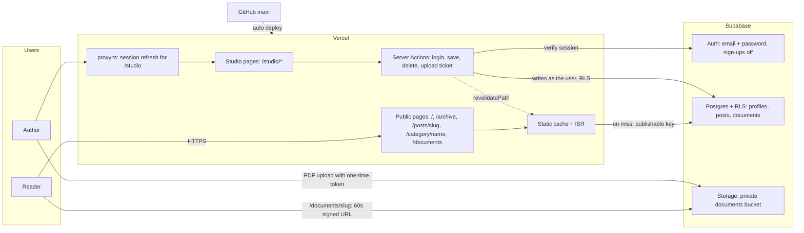
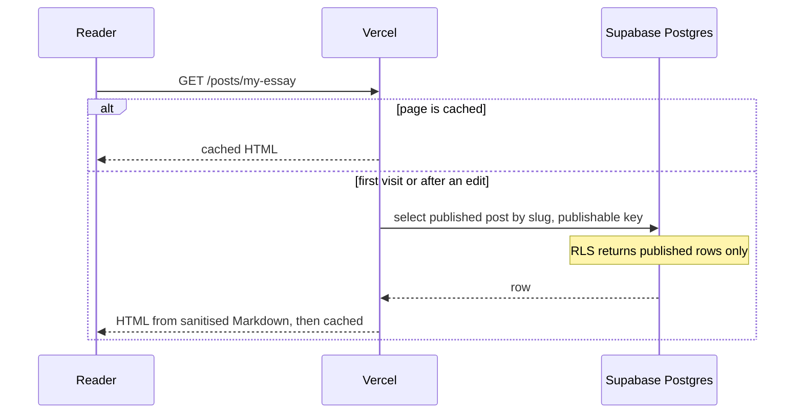
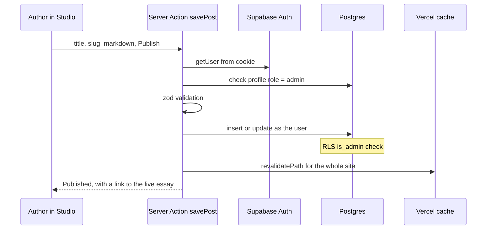
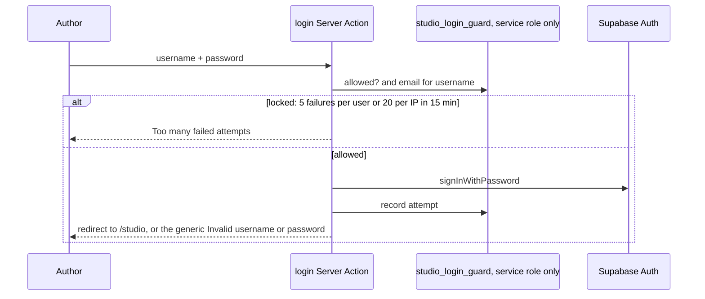
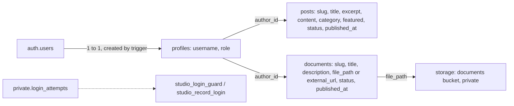

# Emergent Thoughts

> *Essays on ideas that emerge from curiosity.*

A personal essay blog built with **Next.js 16**, **Supabase** and **Tailwind CSS v4**, deployed on **Vercel**.

- Readers get fast, statically cached pages.
- The author writes and publishes from a private, password-protected **Studio** at `/studio`.
- Changes go live within seconds, with no redeploy.

- **Repository:** https://github.com/SanketAdk/Emergent-Blog-
- **Owner / author:** SanketAdk
- **Docs:**
  - [`DEPLOYMENT.md`](DEPLOYMENT.md): go-live runbook
  - [`STUDIO_GUIDE.md`](STUDIO_GUIDE.md): guide for the author
  - [`IMPROVEMENTS.md`](IMPROVEMENTS.md): the plan this work followed
  - [`docs/infrastructure.drawio`](docs/infrastructure.drawio): editable diagrams

> The diagrams below are **Mermaid**, which StackEdit and GitHub draw automatically.

---

## Table of Contents

1. [Tech Stack](#tech-stack)
2. [Architecture](#architecture)
3. [How Data Flows](#how-data-flows)
4. [Security Model](#security-model)
5. [Getting Started (local development)](#getting-started-local-development)
6. [Scripts](#scripts)
7. [Testing](#testing)
8. [Project Structure](#project-structure)
9. [Features](#features)
10. [Database](#database)
11. [Project History](#project-history)
12. [Contributing](#contributing)

---

## Tech Stack

| Layer | Technology |
|-------|-----------|
| Framework | Next.js 16.4 (App Router, Server Components, Server Actions, `proxy.ts`) |
| UI | React 19, Tailwind CSS v4, `@tailwindcss/typography`, shadcn design tokens |
| Database / Auth / Files | Supabase: Postgres with Row Level Security, Supabase Auth, Storage |
| Supabase client | `@supabase/ssr` (cookie sessions), `@supabase/supabase-js` |
| Validation | zod (forms and env variables) |
| Content | Markdown rendered with `react-markdown` + `remark-gfm` + `rehype-sanitize` |
| Testing | Vitest (unit), pgTAP (database), Playwright (end-to-end) |
| CI / Hosting | GitHub Actions, Dependabot, Vercel |

---

## Architecture



---

## How Data Flows

### Reader opens an essay



### Author publishes an essay



### Studio login



---

## Security Model

| Layer | Control |
|-------|---------|
| Database | **RLS on every table.** Anonymous users read *published* rows only. Writes require `profiles.role = 'admin'`. Nobody can change their own role. Grants are least-privilege. |
| Storage | **Private bucket.** PDFs are served through 60-second signed URLs, and only for published documents. Uploads are admin-only, PDF-only and at most 10 MB. |
| Auth | Public sign-ups are disabled. Passwords need 12+ characters with mixed case and a digit. Accounts lock after repeated failures. Errors are generic, so they don't reveal which usernames exist. `?next=` redirects are restricted to `/studio` paths. |
| Server | `requireAdmin()` re-validates the session with `getUser()` on every Studio page and action. Writes run as the user, so RLS applies. |
| Secrets | `SUPABASE_SECRET_KEY` is server-only (`import 'server-only'`) and used only by the login guard and the admin scripts. All `.env*` files are git-ignored except `.env.example`. |
| Content | Markdown is sanitised, which removes scripts and `javascript:` links. |
| HTTP | CSP, HSTS, `X-Frame-Options: DENY`, `nosniff`, `Referrer-Policy`, `Permissions-Policy` and COOP. The Studio is `noindex` and `private, no-store`. |

---

## Getting Started (local development)

**Prerequisites:** Node.js 22+, Docker.

```bash
git clone https://github.com/SanketAdk/Emergent-Blog-.git
cd Emergent-Blog-
npm ci

npm run db:start          # local Supabase in Docker (ports 54421-54429)
npx supabase status -o env
```

Create `.env.local` from the template and fill it with the **local** values printed above: `API_URL`, `PUBLISHABLE_KEY` and `SECRET_KEY`.

```bash
cp .env.example .env.local
```

Then seed the data and start the dev server:

```bash
npm run content:import                                              # original essays + PDFs
npm run studio:create-admin -- --username me --email me@example.com
npm run dev                                                         # http://localhost:3000, Studio at /studio
```

> If `.env.local` holds **production** keys, the scripts refuse to write unless you pass `--confirm`.

---

## Scripts

| Script | Purpose |
|--------|---------|
| `dev` / `build` / `start` | Next.js development server, production build, production server |
| `lint` / `typecheck` | ESLint 9 / `tsc --noEmit` |
| `test` | Vitest unit tests |
| `test:e2e` | Playwright tests (needs a build, local Supabase, `E2E_USERNAME` and `E2E_PASSWORD`) |
| `db:start` / `db:stop` / `db:reset` | Start, stop or reset the local Supabase stack. Reset re-applies all migrations. |
| `db:test` | pgTAP database security tests |
| `db:types` | Regenerate `types/database.types.ts` |
| `db:push` | Apply migrations to the linked (production) project |
| `content:import` | Import `supabase/seed-data` (JSON + PDFs). Idempotent. |
| `studio:create-admin` | Create an admin or reset their password (hidden prompt) |

---

## Testing

| Suite | Count | What it covers |
|-------|-------|----------------|
| `npm test` | 24 | Slugs, form validation, upload limits, password rules, open-redirect guard |
| `npm run db:test` | 26 | RLS for anonymous, non-admin and admin users; privilege escalation; login guard and lockout; constraints |
| `npm run test:e2e` | 14 | Public pages; PDFs; security headers; login security; publish → live → unpublish → delete; PDF upload; XSS sanitising; password change |

CI (`.github/workflows/ci.yml`) runs all of them on every pull request against a throwaway local Supabase.

---

## Project Structure

```
├── actions/                  # Server Actions: auth, posts, documents, account
├── app/
│   ├── page.tsx              # Home (featured + essays)
│   ├── archive/              # Essays by year + category chips
│   ├── posts/[slug]/         # Essay page (SSG + on-demand)
│   ├── category/[name]/      # Essays in a category
│   ├── documents/            # Documents list + [slug] signed-URL redirect
│   ├── studio/(auth)/login   # Studio login
│   ├── studio/(dashboard)/   # Dashboard, essays, documents, account (admin only)
│   ├── sitemap.ts · robots.ts · rss.xml/
│   └── layout.tsx · error.tsx · not-found.tsx
├── components/               # Site components + components/studio/*
├── lib/
│   ├── env.ts · env.server.ts   # zod-validated env (public / server-only)
│   ├── supabase/                # server, client, public (cookie-free), admin, middleware
│   ├── queries.ts               # cached public reads
│   ├── auth.ts · auth-paths.ts  # requireAdmin, redirect guard
│   ├── validation.ts · format.ts · markdown.tsx
├── proxy.ts                  # session refresh for /studio only
├── scripts/                  # content import, create admin
├── supabase/
│   ├── migrations/           # schema, RLS, storage, login guard
│   ├── tests/database/       # pgTAP
│   ├── seed-data/            # original posts.json, documents.json, PDFs
│   └── config.toml
├── tests/unit · tests/e2e
├── types/                    # content.ts, generated database.types.ts
└── .github/                  # CI + Dependabot
```

---

## Features

**Public site**
- Home page with a featured essay, reading time and categories.
- Archive by year, and category pages.
- Essays written in Markdown, with Newer/Older navigation.
- Documents page with PDFs and external links.
- Light/dark mode with no flash of the wrong theme.
- SEO: per-essay Open Graph and Twitter metadata, canonical URLs, `sitemap.xml`, `rss.xml` and `robots.txt`.

**Studio** (`/studio`)
- Username + password login.
- Dashboard with counts and recent edits.
- Essay editor: live Markdown preview, automatic slug, categories, a featured toggle, drafts and publishing, an unsaved-changes warning, and a confirmation before deleting.
- Documents: direct PDF upload or an external link, with publish/draft.
- Account page with a secure password change.

---

## Database



The migrations in `supabase/migrations/` are the source of truth. Constraints enforce:
- a valid slug format
- exactly one source per document (a file or a link)
- `published_at` whenever something is published
- at most one featured essay

---

## Project History

| Date | Milestone |
|------|-----------|
| Jul 2026 | Static Next.js blog: essays in `data/posts.json`; a documents feature was started and then rolled back. |
| Sep–Oct 2026 | Essays added by editing JSON. |
| 24 Nov 2026 | The author added Supabase client helpers and shadcn/ui (`ed34b6a`). That commit didn't build, because it mixed Tailwind v3 and v4. |
| 24 Nov 2026 | **Stage 1** (PR #1): build fixed (Tailwind v4), Next.js security upgrade, `.gitignore` / `.env.example`, cleanup. |
| 24 Nov 2026 | **Stages 2–7**: Supabase schema + RLS, the public site on Supabase, Studio login and content management, SEO, CSP, tests and CI. |

---

## Contributing

1. Create a branch from `main`: `git checkout -b feat/<name>`.
2. Database changes go in a new migration (`npx supabase migration new <name>`), never in an edited one. Then run `npm run db:reset && npm run db:test && npm run db:types`.
3. Before pushing, run `npm run lint && npm run typecheck && npm test`.
4. Open a pull request. CI and the Vercel preview must pass before you merge.
