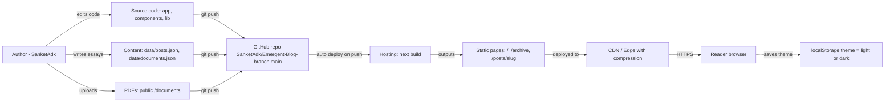
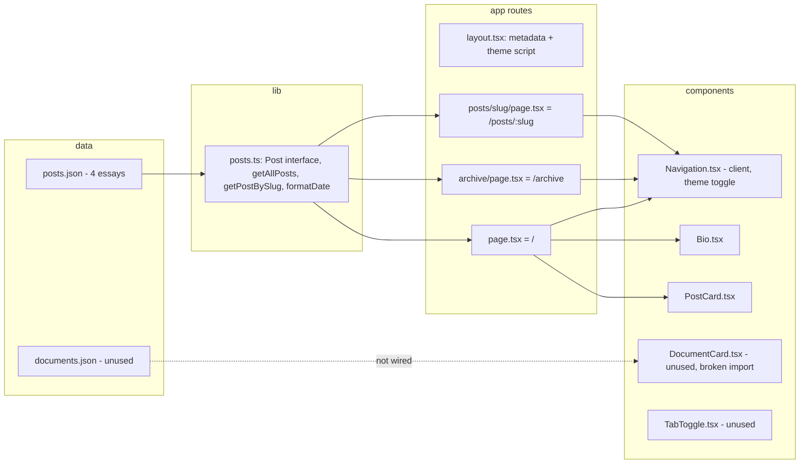
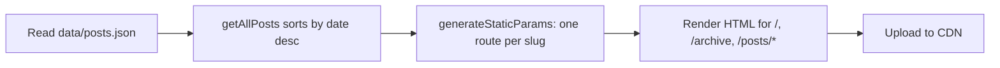
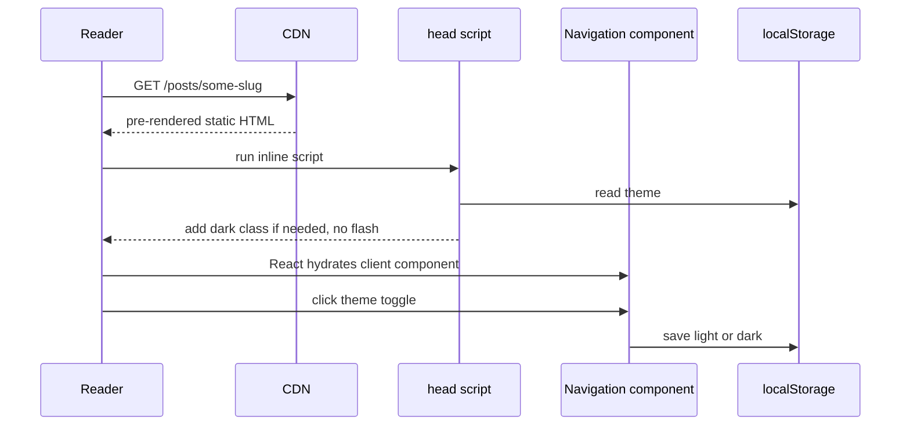
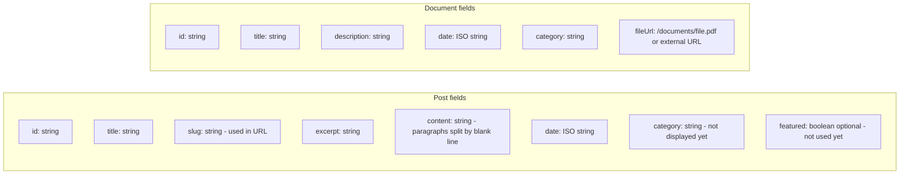
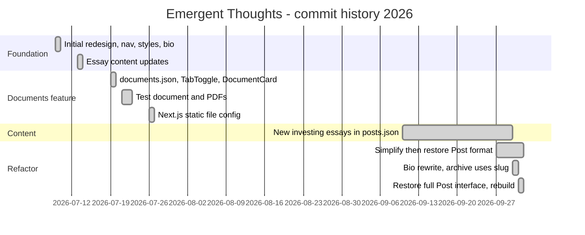
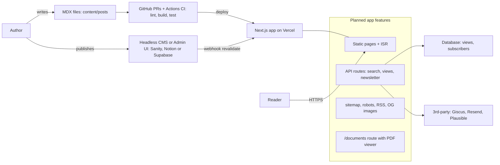
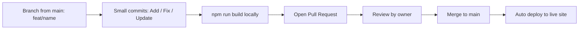

# Emergent Thoughts

> *Essays on ideas that emerge from curiosity.*

A minimalist personal blog built with **Next.js (App Router)**, **React 19**, **TypeScript** and **Tailwind CSS**. Content is stored as JSON files in the repo and rendered as static pages, so there is no database or CMS.

- **Repository:** https://github.com/SanketAdk/Emergent-Blog-
- **Owner / author:** SanketAdk
- **Status:** Live, with content added by hand. This README records the work done so far (54 commits, **9 Jul 2026 → 1 Oct 2026**) as a handover for collaborators who will make the site more advanced and dynamic.

> **About the diagrams**
> - The diagrams below are written in **Mermaid**, which StackEdit and GitHub draw automatically.
> - The same diagrams are also in [`docs/infrastructure.drawio`](docs/infrastructure.drawio), a file with 4 pages that you can open and edit in **draw.io** (https://app.diagrams.net → *File → Open from → Device*):
>   1. Current Infrastructure
>   2. Code Architecture
>   3. Build & Request Flow
>   4. Proposed Dynamic Architecture
>   5. Supabase Information Flow, the plan in [`IMPROVEMENTS.md`](IMPROVEMENTS.md)
> - StackEdit cannot draw `.drawio` files inside Markdown. That is why the README uses Mermaid.

---

## Table of Contents

1. [Tech Stack](#tech-stack)
2. [Infrastructure Overview](#infrastructure-overview)
3. [Code Architecture](#code-architecture)
4. [Build & Request Flow](#build--request-flow)
5. [Getting Started](#getting-started)
6. [Project Structure](#project-structure)
7. [Features Implemented So Far](#features-implemented-so-far)
8. [Content Model](#content-model)
9. [Development Timeline](#development-timeline)
10. [Known Issues & Technical Debt](#known-issues--technical-debt)
11. [Roadmap & Target Architecture](#roadmap--target-architecture)
12. [Contributing Workflow](#contributing-workflow)

---

## Tech Stack

| Layer        | Technology                                    | Version        |
|--------------|-----------------------------------------------|----------------|
| Framework    | Next.js (App Router)                          | `16.2.9`       |
| UI library   | React / React DOM                             | `^19.0.0`      |
| Language     | TypeScript (strict mode)                      | `^5.0.0`       |
| Styling      | Tailwind CSS + PostCSS + Autoprefixer         | `^3.4.19`      |
| Content      | Local JSON files (`data/*.json`)              | n/a            |
| Fonts        | System fonts: Georgia/Garamond (body), system sans-serif (headings) | n/a |

The `next.config.ts` settings are `reactStrictMode: true`, `poweredByHeader: false`, `compress: true` and `staticPageGenerationTimeout: 60`.

---

## Infrastructure Overview

This is how the project runs today. Content and code are in a single GitHub repository. A push to `main` triggers an automatic build and deploy. Readers get pre-rendered static HTML from a CDN.



> **Note on hosting:** the repo has no provider config file, such as `vercel.json`. Commits like *"Test: Trigger rebuild"* show that pushing to `main` deploys automatically, most likely on **Vercel**. Ask the owner which hosting dashboard and domain the site uses.

### Infrastructure inventory

| Component            | Where it lives                        | Notes |
|----------------------|---------------------------------------|-------|
| Source control       | GitHub, `SanketAdk/Emergent-Blog-`    | Single branch `main`. All 54 commits are by SanketAdk. |
| Build                | `next build` on the hosting platform  | Static Site Generation via `generateStaticParams`. |
| Content store        | `data/posts.json`, `data/documents.json` | Edited by hand. A redeploy is needed for every change. |
| Static assets        | `public /documents/*.pdf`             | The folder name has a trailing space, so these files are not served. See Known Issues. |
| Runtime state        | Browser `localStorage`                | Only the theme preference. |
| Database / API / Auth | None                                  | The site is fully static. |
| CI / tests           | None                                  | There are no GitHub Actions workflows. |

---

## Code Architecture



| Module | Type | Responsibility |
|--------|------|----------------|
| `app/layout.tsx` | Server | Root HTML, site metadata, and an inline script that applies dark mode before the page paints. |
| `app/page.tsx` | Server | Home page: Navigation, Bio, and a PostCard for each essay. |
| `app/archive/page.tsx` | Server | Groups essays by year. |
| `app/posts/[slug]/page.tsx` | Server, SSG | Essay page with metadata, a 404 for unknown slugs, and Previous/Next links. |
| `components/Navigation.tsx` | **Client** | Sticky header and the light/dark toggle, saved to `localStorage`. |
| `lib/posts.ts` | Utility | Reads and sorts `posts.json`, finds posts by slug, formats dates. |

---

## Build & Request Flow

### Build time



### Request time



---

## Getting Started

**Prerequisites:** Node.js 20+ and npm.

```bash
git clone https://github.com/SanketAdk/Emergent-Blog-.git
cd Emergent-Blog-
npm install
npm run dev        # http://localhost:3000
```

| Script          | Purpose                          |
|-----------------|----------------------------------|
| `npm run dev`   | Start the local dev server       |
| `npm run build` | Create a production build        |
| `npm run start` | Serve the production build       |
| `npm run lint`  | Run Next.js linting              |

---

## Project Structure

```
Emergent-Blog-/
├── app/
│   ├── layout.tsx            # Root layout, metadata, no-flash dark-mode script
│   ├── globals.css           # Tailwind layers + global typography & theme colors
│   ├── page.tsx              # Home: navigation, bio, list of essays
│   ├── archive/page.tsx      # All essays grouped by year
│   └── posts/[slug]/page.tsx # Single essay page (statically generated)
├── components/
│   ├── Navigation.tsx        # Sticky header + light/dark theme toggle (client)
│   ├── Bio.tsx               # Intro paragraph on the home page
│   ├── PostCard.tsx          # Essay preview card
│   ├── DocumentCard.tsx      # Document card (unused, broken import)
│   └── TabToggle.tsx         # Essays/Documents tab switcher (unused)
├── data/
│   ├── posts.json            # Essay content
│   └── documents.json        # Document/PDF metadata
├── docs/
│   └── infrastructure.drawio # Editable draw.io diagrams (4 pages)
├── lib/posts.ts              # Post type + data helpers
├── public /documents/        # PDFs (folder name has a trailing space)
├── next.config.ts
├── tailwind.config.ts        # darkMode: "class"
├── postcss.config.mjs
└── tsconfig.json             # "@/*" path alias → project root
```

---

## Features Implemented So Far

### Pages & routing
- **Home (`/`):** sticky navigation, a single-paragraph bio, the full list of essays (newest first), an empty-state message and a link to the archive.
- **Essay page (`/posts/[slug]`)**
  - Pre-rendered at build time with `generateStaticParams`.
  - Sets a per-post `<title>` with `generateMetadata`.
  - Returns a 404 through `notFound()` when the slug is unknown.
  - Splits the body into paragraphs on blank lines.
  - Has **Previous / Next** links between essays.
- **Archive (`/archive`):** every essay grouped by **year**, with a total essay count.

### UI / UX
- **Light/dark mode**
  - The toggle in the navigation bar saves the choice to `localStorage`.
  - With no saved choice, the site follows the OS setting.
  - The theme is applied before the page paints, so there is no flash of the wrong theme.
- **Editorial typography:** serif body text, sans-serif headings, a narrow reading column and smooth scrolling.
- **Responsive** layout built with Tailwind utility classes.

### Content
- **4 essays** published (Investing ×3, Philosophy ×1):
  - *What Actually Makes me think* (2025-06-24)
  - *The Need For A Mental GYM* (2026-07-13)
  - *Investing In Early Business* (2026-09-10)
  - *Are We Facing Economic Slowdown Or Just Being More Cautious?* (2026-09-12)
- **2 documents** listed in `documents.json`: a Cyclical Businesses Reference PDF and a test entry linking to a Google Doc.

### Documents section (started, then rolled back)
In July 2026 a feature was built to show **Essays** and **Documents** as tabs on the home page. It used `documents.json`, document helper functions in `lib/posts.ts`, and the `TabToggle` and `DocumentCard` components.

In late September the home page and `lib/posts.ts` were changed back to essays only. The components and data files are still in the repo but nothing uses them.

---

## Content Model



**Adding an essay today:** add an object to `data/posts.json`, commit, and push to `main`. The hosting platform rebuilds the static pages.

---

## Development Timeline



| Date (2026)    | Milestone |
|----------------|-----------|
| **Jul 9**      | Initial commit: *"Emergent Thoughts redesigned"*. Navigation, global styles and bio were adjusted. |
| **Jul 13**     | Essay content updated. |
| **Jul 19**     | **Documents feature built:** data file, helper functions, `TabToggle`, `DocumentCard`, home page tabs, and PDFs. |
| **Jul 21–22**  | Test document added; `documents.json` updated. |
| **Jul 26**     | Next.js config adjusted for serving static files. |
| **Sep 10–29**  | Several content updates to `posts.json`. |
| **Sep 27**     | Post format simplified, then reverted. Home page went back to essays only. |
| **Sep 30**     | Single-paragraph bio; the archive now links by `slug`. |
| **Oct 1**      | Full `Post` interface restored; rebuild triggered. |

---

## Known Issues & Technical Debt

> **Update (24 Nov 2026), Stage 1:**
> - Issues 1, 2, 3, 4, 5 and 7 are fixed.
> - The project now uses Next.js 16.4.6, which fixes a critical security advisory, and Tailwind CSS v4, which the author's shadcn/ui setup needs. Before this, the build failed on `border-border`.
> - ESLint and a `typecheck` script were added.
> - Baseline security headers are set.
> - `.env.example` was added.
> - Issue 6 (`prose`) is planned for Stage 3. See [`IMPROVEMENTS.md`](IMPROVEMENTS.md).

1. **`DocumentCard.tsx` imports a type that no longer exists.** It imports `Document` from `@/lib/posts`, which no longer exports it. This can break `next build` type checking.
2. **The `public ` folder name has a trailing space.** Next.js only serves files from `public/`, so links to the PDFs will **404**. Rename the folder to `public/`.
3. **The PDF file names contain spaces and odd dots** (`Ielts .pdf`, `Test Document..pdf`). Use URL-safe names instead.
4. **`.DS_Store` files are committed, and there is no `.gitignore`.**
5. **`getAllPosts()` sorts the imported JSON array in place.** Use `[...posts].sort(...)` instead.
6. **The `prose` classes do nothing.** `@tailwindcss/typography` is not installed.
7. **Theme initialisation is duplicated** in both `layout.tsx` and `Navigation.tsx`. `Navigation` also renders an empty placeholder until it mounts, which causes a small layout shift.
8. **Post bodies are plain text only.** There is no Markdown, links or images.
9. **`category` and `featured` are stored but never shown.**
10. **No SEO extras:** no Open Graph metadata, sitemap, RSS feed or favicon.
11. **No tests or CI.**

---

## Roadmap & Target Architecture

The proposed architecture after the roadmap is complete:



### Phase 1: Stabilise
- [ ] Fix Known Issues 1–6 (build safety, `public/` folder, `.gitignore`).
- [ ] Add ESLint + Prettier and a GitHub Actions workflow that runs `lint` and `build` on every pull request.

### Phase 2: Richer content
- [ ] Move essays to **MDX** files with front-matter (`gray-matter` + `next-mdx-remote`).
- [ ] Add `@tailwindcss/typography` for article styling.
- [ ] Show categories/tags and reading time, and add category pages.
- [ ] Bring back the **Documents** section as a `/documents` route with an inline PDF viewer.
- [ ] Add a "Featured" essay to the home page.

### Phase 3: Dynamic features
- [ ] **Search** across essays (Fuse.js or an API route).
- [ ] **Headless CMS or database**, so the owner can publish without editing JSON. Use ISR or on-demand revalidation so new posts appear without a full redeploy.
- [ ] **Comments** (Giscus) and reactions.
- [ ] **Newsletter sign-up** (Buttondown or Resend).
- [ ] **View counts** and analytics (Vercel Analytics or Plausible).

### Phase 4: Polish & reach
- [ ] SEO: Open Graph and Twitter cards, dynamic OG images, `sitemap.ts`, `robots.ts` and an **RSS feed**.
- [ ] An About page, social links and a contact form.
- [ ] Accessibility pass and a Lighthouse score of 95+.

---

## Contributing Workflow



1. Create a feature branch from `main`: `git checkout -b feat/<short-name>`.
2. Keep commits small and descriptive, using the existing style: `Add: …`, `Fix: …`, `Update: …`.
3. Run `npm run build` locally before pushing.
4. Open a Pull Request against `main`, with screenshots for UI changes.
5. Don't push straight to `main`; the live site rebuilds from it.

---

*README written on 24 Nov 2026 from the repository's code and commit history. Editable diagrams: [`docs/infrastructure.drawio`](docs/infrastructure.drawio).*
